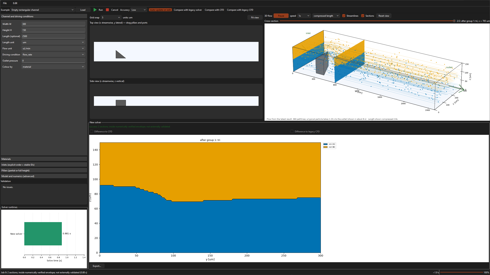
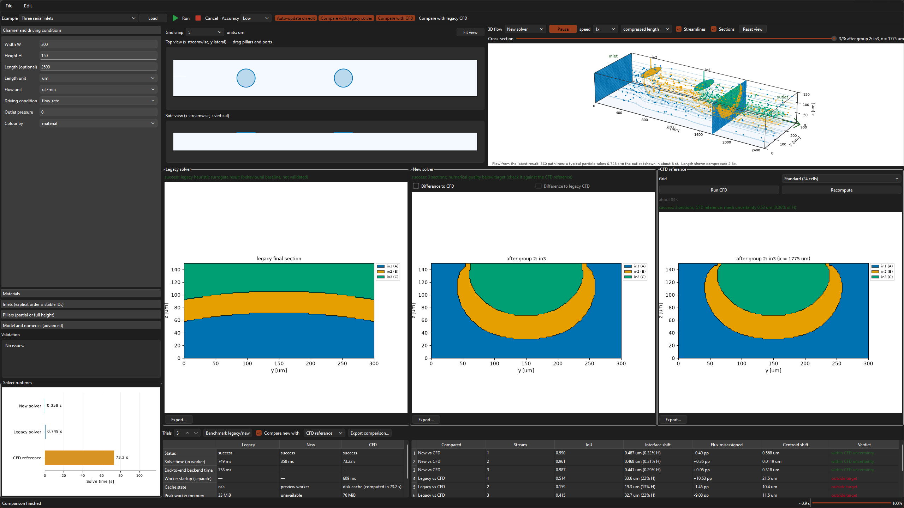

# Reduced-order crossflow simulator

**Explore how microfluidic channels sculpt fluid streams in 3D.**

Define channel geometry, pillars, and inlet streams, then watch how the flow reshapes material
cross-sections along the channel. The desktop interface brings together animated 3D flow,
synchronized cross-section plots, and runtime comparisons. Compare solver predictions side by
side against a CFD reference, or use the command line to run cases and export results.

- **New solver:** grouped 3D Stokes flow calculations with continuous material transport.
- **Legacy:** frozen original heuristic model.
- **CFD reference:** a full-channel 3D Navier Stokes calculation. Based on [OpenFOAM/OpenFOAM-13](https://github.com/OpenFOAM/OpenFOAM-13)
- **Legacy CFD:** stored COMSOL streamline maps; original solve times are unavailable. Code from [Yiyingzou/3D-hydrodynamic-flow-sculpting](https://github.com/yiyingzou/3D-hydrodynamic-flow-sculpting)

## Screenshots

New solver: triangular pillar, 3D flow, cross-section, and runtime.



Three-solver comparison at Medium accuracy: New meets all three stream targets; Legacy misses
all three. The CFD reference uses 24 cells. Timings vary with hardware and caching.



## Install

Windows, Python 3.11+:

```powershell
python -m venv .venv
.\.venv\Scripts\python.exe -m pip install -r requirements/dev.txt
.\.venv\Scripts\python.exe -m pip install --no-deps -e .
```

Use `requirements/app.txt` instead for runtime dependencies only. Legacy CFD pillar cases also
need the [upstream map libraries](3D-hydrodynamic-flow-sculpting/README.md).

## Run

```powershell
.\.venv\Scripts\crossflow-gui.exe
.\.venv\Scripts\crossflow.exe run examples/right_triangle_bottom.json --figure sections.png
.\.venv\Scripts\crossflow.exe compare examples/square_library_pillars.json --cfd --legacy-cfd --export report/
```

In the GUI, select an example and **Load**, then **Run** (F5). Toolbar toggles enable comparisons;
Accuracy controls the New solver's grid. Auto-update runs it after edits. The slider in the 3D
preview selects a calculated cross-section and updates matching plots without rerunning.
**Export** saves results; **F11** toggles fullscreen.

Projects are JSON files with SI units internally. Medium accuracy meets the documented comparison
targets on all tested examples; higher accuracy is not always better. The CFD reference shares
numerical methods with the New solver and does not provide independent experimental validation.

## Development

```powershell
.\.venv\Scripts\python.exe -m pytest -q
.\.venv\Scripts\python.exe benchmarks/run_benchmarks.py --trials 3
.\.venv\Scripts\pyinstaller.exe --noconfirm packaging/crossflow.spec
.\.venv\Scripts\python.exe packaging/smoke_test.py dist/crossflow
```

Application code is in `src/crossflow_simulator/`; sample projects in `examples/`; checks in
`tests/`. Frozen upstream implementations live in `legacy/` and `3D-hydrodynamic-flow-sculpting/`.
Packaged builds include GPL-3.0 upstream code and must follow its licence requirements.

- [Architecture and code walkthrough](docs/architecture.md)
- [CLI options](src/crossflow_simulator/cli.py) (`crossflow --help`)