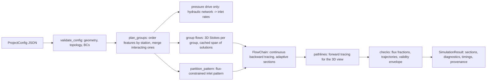

# Architecture

This document describes the implementation as built. Paths are relative to the repository root.

## Pipeline

`crossflow_simulator.simulator.simulate(config, progress, cancel)` is the single application
service. The CLI, the GUI worker, benchmarks, and tests all call it.

Every stage checks for cancellation. Invalid input, numerical failure (for example an unconverged
Stokes solve) and cancellation produce `status = failed | cancelled`, never a silent result.

`crossflow_simulator.cfd.run_cfd(config, progress, cancel)` is the second service: the CFD
reference that the new solver is compared against (see below). It returns the same
`SimulationResult` contract, with `backend = "cfd"`. The legacy CFD (`legacy_cfd.py`) runs the
vendored 3D-hydrodynamic-flow-sculpting tool on a translated project and returns the same contract
with `backend = "legacy_cfd"`.

## Conventions

* SI units internally. The JSON keys carry unit suffixes, and the GUI converts only for display.
* `x` is streamwise, `y` lateral (`0..W`), `z` vertical (`0..H`).
* Cross-sections are stored `[z, y]` on a cell-centred grid. Legacy and legacy CFD results keep
  their native wall-inclusive nodal grids (`grid_kind="legacy_nodes"`; 250 x 250 for legacy CFD)
  and are regridded only for display and metrics, and the operation is labelled.
* 3D staggered fields are `[x, y, z]`: `u (nx+1, ny, nz)`, `v (nx, ny+1, nz)`, `w (nx, ny, nz+1)`.
* Stream codes are the 1-based positions of the inlets in the project. Colours are keyed by
  material ID (`materials.py`).

## Physical models

**Inlet pattern (`inlets.py`).** The channel is filled at `x = 0` by an explicit pattern: a
single inlet, lateral or vertical layers, or a rows x cols grid. Patch boundaries are placed so
that every inlet carries exactly its own flow rate under the developed velocity field. Grids
with non-separable rates get a staggered partition, which is reported. Forcing an aligned
partition that cannot carry the rates is an error. With a viscosity contrast the developed
profile is recomputed from the partition (`solvers/section.py`, harmonic face viscosity) until
the partition converges. Nothing is inferred from coordinates. `infer_pattern_from_points`
exists only for importing legacy-style setups, and it rejects ambiguous layouts.

**Feature groups (`models/domain.py`).** Ports and pillars are sorted by their streamwise
extent. Features closer than the interaction distance (default: upstream plus downstream margin)
share one group and one coupled domain. Pillars with a common group ID form a composite solid.
Each domain covers its features plus margins in which the flow is fully developed. Grid spacing
is fine near features and graded towards the margins. Faces are aligned with pillar heights, so
the height is represented exactly. Pillars are voxelized by footprint coverage of at least 0.5.
Ports are circular Poiseuille inflows on wall faces, scaled to exact unit flux.

**Stokes solver (`solvers/stokes.py`).** Staggered finite volumes in symmetric energy form,
`A = 2 Dn^T (mu V) Dn + 4 Ds^T (mu_e V_e) Ds`. Constant and variable viscosity share one path.
Tangential no-slip uses ghost reflection at walls and at solid surfaces. The operators are
assembled nondimensionally. The saddle-point system is solved with MINRES and a block
preconditioner: a Ruge–Stüben AMG V-cycle per velocity component (pyamg; exact block LU as
fallback) and the scaled pressure mass for pressure. Direct SuperLU is used only below 15k
unknowns, because 3D fill-in made it about 270 s at 95k unknowns. The true residual is checked
after every solve. A solve can take a body force (integrated over the momentum control volumes)
and a warm start; the CFD reference uses both for its Picard iterations. Several ports on one
wall add their inflow profiles (before the CFD reference, every group had at most one port per
wall, which hid an overwrite in the boundary values).

**Superposition (`models/stokes_map.py`).** For equal-property creeping flow the field is linear
in the source rates `[upstream, port_1, ...]`. Solutions are kept per geometry together with
their normalized rate vectors, in memory and on disk. A new request inside their span is a
superposition, and anything else costs exactly one additional solve. A common viscosity scales
only pressure. Viscosity contrasts use the experimental coupled path. It traces every fluid cell
to its source, rebuilds the viscosity field and the developed boundary profiles, and re-solves
until the material assignment converges.

**Transport (`transport.py`, `maps.py`).** Streamlines are integrated in arc length with an
adaptive midpoint rule that controls the local error (default 1e-3 of a flow cell per step).
Interpolation is trilinear on each staggered lattice. It uses reflection ghosts and a quadratic
decay of the wall-normal component next to no-penetration faces, because no-slip plus continuity
require it. Near-wall approach is limited to half the remaining distance per step (except over
ports), and so is approach to voxel faces. Every trajectory ends with an explicit status:
`reached_plane`, `reached_opening`, `wall_contact`, `entered_solid`, `stagnation` or
`max_length`. Invalid trajectories are counted, never clamped. After a section is traced,
`fill_trajectory_gaps` (`maps.py`) gives its cells without a valid trajectory the most common
stream label of their valid 8-neighbours (ties: nearest valid cell centre, then the lower code).
It repeats rounds so small patches fill from the outside in, and never fills or reads across solid
cells (`section_solid`: pillars cut by the section plane). It fills only 8-connected patches of at
most `model.max_fill_cells` cells (default 100), and nothing when more than 1% of the flow cells
failed; unfilled cells stay grey with a warning. The fill works on the section's codes only: the
donor map that later sections compose with and that the map cache stores keeps the raw result, so
fresh and reused maps give identical sections. Each section keeps the raw per-cell `status`, a
boolean `filled` array (saved in the result file and exports), `trajectory_status` with
`filled_from_neighbours`, and `trajectory_fill` (failed, filled, unfilled, unfilled patch sizes).
The validity check judges the share that failed before filling. The fill counts remain in the result diagnostics and exports. In conservative transport, cells that no
traced fluid reaches get the one-hot fractions of their filled label in the shown section only.

Sections are computed by tracing output points backward through all groups down to `x = 0`
(`FlowChain`). The analytic inlet pattern is evaluated once, at the final donor coordinates.
`adaptive_section` traces a coarse lattice, refines cells with mixed origins or where the map
bends by more than a quarter output cell, interpolates elsewhere, and spot-checks the
interpolated points. Downstream sections reuse the stored donor maps of upstream sections where
they are locally smooth. `subcell_fractions` supersamples each output cell, so flux diagnostics
are not dominated by pixel quantization.

**Pathlines (`pathlines.py`).** For the 3D view only, 360 flux-weighted seeds are traced forward
from the inlets to the outlet: inlet-pattern seeds are weighted by the developed axial velocity,
and port seeds by port flow rate and the Poiseuille inflow profile. Inside a group they use the
same tracer as the sections, stopping at the group's graded x faces to record positions and
residence times. Between groups they move straight with the developed velocity. They cost 1–30 ms
per run and are stored in the result (`SimulationResult.pathlines`). They are reused and
recoloured with the section maps, and never feed sections or diagnostics. If they cannot be
computed, the run records a warning instead of failing.

Quantitative mode (`model.transport = "conservative"`) applies a sparse, column-normalized
transfer per group (`ConservativeRemap`). It conserves each stream's flux exactly and reports
lost thin regions.

**Pressure drive (`solvers/network.py`).** Inlet pressures behind tubing resistances feed channel
nodes at the port stations. Segment resistances are duct resistances plus the extra resistance
of each pillar group from its Stokes solution. Junction losses are neglected, and inlet backflow
is rejected.

**Validity (`models/validity.py`).** Model cards list assumptions and verification evidence.
Every result carries checks of two kinds. *Envelope* checks cover the physics: Re at most 1,
viscosity ratio, and H/W. *Numerics* checks cover resolution, a per-stream flux-fraction error of
at most 0.5 pp, and invalid trajectories at most 0.5%. The status reads "inside numerically
verified envelope", "numerical quality below target", "outside verified envelope" or
"experimental". `externally_validated` stays false until external references pass
(`calibration.py`).

**CFD reference (`cfd.py`, `solvers/convection.py`).** The ground truth for the reduced-order
solver. It removes the new solver's modelling assumptions:
* feature groups with developed flow at their margins, one domain each;
* inertia neglected;
* the map lattice and map composition;
* the developed velocity used for section fluxes.

What it does instead:

* One staggered grid covers the whole channel. It runs from an inflow buffer upstream of `x = 0`
  to an outflow buffer downstream of the outlet, each `cfd.buffer` channel sizes long (default 2).
  The grid is refined at every pillar and port and grows to 4 fine cells elsewhere. Faces are
  snapped onto pillar heights, footprint extents, and axis-parallel footprint edges. The inlet
  pattern enters developed at the far end of the inflow buffer.
* Steady incompressible Navier–Stokes. Inertia enters through Picard iterations. Every iterate is
  `u_stokes + S0(G)`: a step solves the Stokes operator with zero boundary values and the change
  in the lagged convective force `-rho (u . grad) u` as body force, under-relaxed if the steps
  grow. The convective operator is central and second-order accurate on analytic fields. It uses
  the tracer's no-slip reflection ghosts. Density is the flux-weighted mean.
* With a viscosity contrast, every fluid cell is traced to its source. The flow is then solved
  again with the resulting viscosity field and the variable-viscosity inflow and outflow
  profiles, until less than 0.1% of the cells change material. These iterations use creeping
  flow; inertia is added once, on the converged viscosity field.
* With pressure drive, one creeping-flow solve per source (the inlet pattern and each port) gives
  the channel's exact resistance matrix between the nodes (`x = 0`, the ports, and the outlet at
  the channel length). Together with the supply pressures and tubing resistances it gives the
  rates, and the field is their superposition. A viscosity contrast with pressure drive is
  reported as unsupported.
* Every output cell of every section is traced back individually (tracing tolerance 2.5e-4
  instead of 1e-3). Cells on an interface or without a valid path are sampled 3 x 3 times for
  their flux fractions. Section fluxes use the computed axial velocity. Sections are taken at the
  new solver's stations, so the two results compare station by station.
* A backward path that passes a stagnation line on a pillar face can be trapped: arc-length steps
  overshoot the zero-velocity point back and forth. Such fluid lies on the dividing surface between
  two routes around the pillar. The path is restarted one fine cell upstream of where it stalled,
  and restarts are counted per section (`restarted_at_stagnation`).
* With a viscosity contrast, faces are also snapped onto the inlet layer boundaries, so the
  imposed variable-viscosity inflow splits the flux exactly as the pattern prescribes.
* A second grid with 2/3 of the cells estimates the reference's own uncertainty. The *interface
  shift* between the grids (the area where a stream differs, divided by its interface length) is
  converted with a grid convergence index at first order and safety factor 1.25:
  `U = 1.25 * shift / (r - 1)`. First order is assumed because staircase pillars with slanted
  edges converge noisily.

The checks are:
* linear residual;
* cell divergence;
* flux through every cross-section plane (continuity, ports excluded);
* Picard and viscosity-coupling convergence;
* invalid trajectories;
* flux conservation;
* mesh uncertainty against 2% of H.

A Picard iteration that does not converge fails the run. The reference shares the finite-volume
building blocks and the tracer with the new solver. It is therefore a higher-fidelity numerical
reference, not an independent code, and its model card says so. CFD from another code, imported
as `crossflow-reference/1`, remains the independent check.

**Legacy CFD (`legacy_cfd.py`, `3D-hydrodynamic-flow-sculpting/`).** The repository root holds
a byte-exact copy of [yiyingzou/3D-hydrodynamic-flow-sculpting](https://github.com/yiyingzou/3D-hydrodynamic-flow-sculpting)
at revision `b6912d3` (GPL-3.0, see its `LICENSE`). `legacy_cfd.UPSTREAM_FILES` pins the SHA-256
of all 16 files, and `.gitattributes` keeps git from converting their line endings. The tool
predicts sections by chaining index maps that its authors built from COMSOL streamline exports,
one map per geometry, on a 250 x 250 section grid. The map libraries (pillar 214 MB, inlet 135
MB, outlet 1 MB) and the raw COMSOL streamlines they were built from (4.8 GB) are not in the
repository. They are unpacked from the published archives into
`3D-hydrodynamic-flow-sculpting/generated_library_*/` and `streamline_files_*/` (git-ignored), or
the libraries into a folder named by `CROSSFLOW_LEGACY_CFD_LIBRARIES`. A project without pillars
needs no library. The published pillar library holds 900 maps, all for `cw = ch = 1.5`. Maps drawn
at random are bit-for-bit what upstream's `library_generation_pillar.py` builds from the raw
streamlines.

`build_plan` translates a project, or says why it cannot:

* **Pillars.** Lengths scale by `W / 1.5` (library channel 1.5 x 1.5). A triangle whose base edge
  lies across the channel gives the parameters `cw, ch, ph, ya, yb, xc, yc`. Its library key is
  the entry of the parameter tree (`library_pillar_dict.npy`) within 0.01 library units (0.67% of
  W). If no entry is that close, the reason names the nearest entry and the difference in um.
* **Symmetries.** The library pillars stand against `z = ch`, so they are top-mounted in this
  project's frame. This is measured, not assumed: in the raw streamlines of a pillar a quarter of
  the height tall, the displacement behind its base is about 5x larger next to `z = ch` than next
  to `z = 0`. On a pillar of three quarters of the height, this reading agrees with the CFD
  reference at IoU 0.90, against 0.71 for the opposite one. A bottom-mounted pillar uses the
  z-reflected map, and a pillar whose mirror image is in the library uses the y-reflected map
  (`R o map o R`). Both are exact symmetries of the square channel. `tests/test_legacy_cfd.py`
  repeats the streamline check when the raw data is installed.
* **Inlet pattern.** The new solver's flux-constrained partition is evaluated at the 250 x 250
  nodes and set as the upstream inlet profile. The upstream helper `create_initial_flow_profile`
  is not used: it rounds every layer boundary down to a whole node. On 1:2:3 layers that alone
  misassigns 0.8 pp of the flux; with node evaluation, straight channels match the new solver
  exactly.
* **Stations.** Sections are reported at the new solver's stations (inlet plane and after each
  feature group).
* **Not supported:**
  * pillar maps in non-square channels;
  * ports (the inlet library's operator width `ow` and port position `ip` have no documented
    reference frame);
  * pressure drive;
  * viscosity contrasts;
  * composite pillars;
  * non-triangular footprints.

The library files are pickled NumPy dictionaries. `legacy_cfd_worker.load_library_file` reads the
`.npy` header itself and unpickles with a restricted unpickler. It resolves only NumPy array and
scalar reconstruction, and any other global is refused, so a manipulated library cannot run code.
This applies to both `.npy` and `.npy.gz`.

## Caching and invalidation (`cache.py`)

| Cache | Key contains | Reused when |
|---|---|---|
| duct profiles | geometry, coordinates, method, normalization, terms | same grid and settings |
| lubrication factorizations | transmissibility arrays | same conductance field |
| Stokes solution span (memory + disk NPZ) | grid, solid mask, opening profiles, tolerance | same geometry; any rates in the span |
| section donor maps and pathlines (memory) | group domain keys, *flux fractions*, output grid, tracing settings, outlet position | only the pattern changes (materials, colours, pattern ratios at equal port fractions), common viscosity or overall flow scale; pathline times are rescaled and pattern seeds recoloured |
| CFD flow fields (disk, one per grid level) | channel, active pillars, operating conditions, pattern and port rates (the full inlets, pattern and materials with a viscosity contrast or pressure drive), viscosity, mean density, CFD settings, outlet position | only colours, the output grid, the new solver's settings, or the pattern arrangement at equal rates change; the sections are traced again (seconds) |
| CFD results (disk) | field keys, stations, output grid, inlets, pattern, materials | same case; loaded instantly when the comparison is switched on and re-stamped with the current input hash |

Coupled viscosity runs and conservative transport are never served from the map cache. Memory
caches are LRU with a byte budget (`CROSSFLOW_MEMORY_CACHE_MB`). The disk cache lives under
`%LOCALAPPDATA%\crossflow_simulator\cache`, can be moved with `CROSSFLOW_CACHE_DIR`, and can be
disabled with `CROSSFLOW_DISABLE_DISK_CACHE=1`.

## Backends and isolation (`backends/`)

The old and new packages are both named `crossflow_simulator`, so each runs in its own process.

* **New worker:** `python -I -c <boot> <src>` imports the new package from the explicit source
  root. The hello message reports the loaded path and any foreign modules.
* **Legacy worker:** `python -I backends/legacy_worker.py --legacy-src ... --manifest ...` is a
  standalone script. It installs a meta-path finder that resolves `crossflow_simulator.*` only
  from `legacy/python/src`, verifies every archived source hash against `legacy/manifest.json`,
  and refuses to start if anything differs. It executes an explicit plan of original operators
  built by `backends/legacy.py`, because the archived `simulator.py` is empty. The adapter states
  its conventions and returns *not supported by legacy* reasons (viscosity contrast, pressure
  drive, top-mounted pillars, side-wall ports, composite pillars) instead of simplifying.
  The legacy secondary-flow operator resamples labels at the nearest node after every step, and
  its own default of 120 steps moves labels less than half a cell per step on any grid below
  about 500 nodes, so pillars would never change the section. Unless `legacy.secondary_steps`
  is set explicitly, the adapter therefore picks the largest step count at which one step spans
  one cell of the coarser grid direction (9 steps on the default 160 x 80 grid). The worker
  records the fraction of labels each operation changed; a pillar operation that changed none
  produces a warning.
* **CFD worker:** the new-solver worker with `"solver": "cfd"` jobs, in its own process
  (`backends/cfd.py`), so a CFD solve of a minute or more never delays auto-update previews and can
  be cancelled by restarting its worker. The CFD settings (`cfd` in the project file: cells, grid
  convergence check, inertia, buffers) are excluded from the new solver's input hash; the CFD's
  staleness uses its own result key.
* **Legacy CFD worker:** `python -I backends/legacy_cfd_worker.py --upstream ... --expect-sha256
  ...` is a standalone script, like the legacy worker. It checks the upstream `computation.py`
  against its pinned hash and imports it by path. It never imports the new package, and the hello
  message reports any `crossflow_simulator` module as an isolation problem. It loads the pillar
  library once and keeps it in memory between jobs. It registers the chosen, possibly reflected,
  maps in `flowsculpting.map_lib`, and it calls the unchanged
  `compute_and_generate_new_flow_profile` for every prefix of the operator sequence (one section
  per station). The per-map changed fraction and the library's SHA-256 go into the result.
* **Protocol:** JSON lines on stdin/stdout. Results travel as NPZ files. Progress messages are
  rate-limited. Cancellation is cooperative, and a blocked worker is killed and restarted on the
  next request. `WorkerClient` assigns monotonically increasing job IDs.

## Comparison (`comparison.py`, `gui/comparison_view.py`)

All backends receive the same input. `ComparisonService.run_set` runs any subset of
`new`, `legacy`, `legacy_cfd` and `cfd` sequentially in already-started workers. The new solver
runs first, so its result appears while the others are still running. Legacy CFD takes
milliseconds, so it runs before the CFD reference. The legacy benchmark protocol alternates
the order and reports cold (startup plus first solve), warm uncached, and cached scopes with
medians and IQR. A legacy/new speedup is shown only for two successful runs with the same timing
scope.

* **Legacy against new.** Metrics are per-stream IoU, interface distance, flux fractions, and
  centroid shift. They use legacy labels regridded by nearest neighbour onto the new grid, and the
  native results are kept. They are behavioural only.
* **Legacy CFD against new.** The same metrics as for legacy, at the selected station. They are
  behavioural only.
* **Accuracy against the CFD reference** (`accuracy_against`), for the new solver and legacy CFD at
  any station and for legacy at the final section. All are measured on the CFD grid:
  * per-stream IoU;
  * interface shift;
  * boundary distance;
  * centroid shift;
  * *flux misassigned*: the share of the flow, weighted with the CFD's own axial velocity, that
    lands in another stream.

  The acceptance targets are those of the validation workflow: IoU at least 0.90, flux
  misassigned at most 0.5 pp, and an interface shift of at most 2% of H widened by the CFD's
  mesh uncertainty. A shift below that uncertainty is reported as "within CFD uncertainty": the
  reference cannot resolve it.
* **Speed against the CFD** is the CFD compute time (measured when it was computed, also when it
  is served from the cache) divided by the solve time.

The export contains every native result, the aligned legacy differences, a figure with all final
sections side by side, timings, the protocol, the effective configurations, the snapshot version,
and the accuracy record.

## GUI (`gui/`)

One window, no tabs. The left column holds the setup and a horizontal bar chart comparing
measured solve times for the new solver and selected legacy/CFD reference solvers. Legacy CFD
is excluded because its original precomputation time is unavailable. The chart replaces
the operation sequence panel; features remain editable in setup and the geometry editor.
Unrun or unsupported solvers show a state rather than a zero runtime, and old-input results
are marked stale. CFD bars use the original compute time when loading a cached result.
The right side shows the geometry editor and animated 3D
flow view above the solver results.

The menu bar contains only File and Edit. The toolbar holds examples, Run (F5), Cancel (Esc),
auto-update, Accuracy, and the three comparison toggles. Accuracy selects the new solver's flow
resolution: Low = `preview` (12 cells across the smaller channel dimension), Medium = `medium`
(18), High = `reference` (20). It is saved with the project and participates in result staleness.

The visible solver panes share a horizontal row. Their plotted cross-section rectangles have
identical pixel dimensions and aligned z=0 lines, recalculated after toggling comparisons.
Pane dividers are locked. The main window can resize or maximize, and F11 toggles fullscreen,
returning to the prior normal or maximized state. There are no
per-solver diagnostic trees or Matplotlib navigation icon toolbars. Each pane retains its run
status and output plot, with a bottom-left Export button for its native result, project snapshot, sections
figure, and diagnostics. The new solver also exports the 3D view. Detailed numerical records
remain in the result files and exports.

The new solver has two difference checkboxes side by side above its plot.
The Materials and Interfaces controls are removed; interfaces remain visible.
The station slider is in the top-right 3D preview, with the selected section name and x position.
Dragging it updates the visible 3D slice, New solver section, matching CFD sections, overlays,
and agreement metrics without recalculating. It defaults to the final section after a run and
is disabled before results are available or while those results are stale.
Intermediate sections remain in the result data and exports.
Successful current results display their run message in green; stale
results display it in red. The CFD pane retains its grid choice, Run CFD, Recompute, estimate,
and progress. Recompute deletes this case's stored result and fields before computing anew.

Below the plots, the performance and agreement tables remain, together with the benchmark,
reference chooser, and comparison export. The detailed bottom summary text is removed.
Solve time shows actual computation duration; the CFD's saved computation time is retained on
cache loads. End-to-end backend time likewise retains the original CFD submission-to-result-load
measurement, persisted with the cached result. Older cache entries without this measurement
show it as unavailable until recomputed. The legacy CFD's Solve time shows an em dash for all
cases: map application measures a different operation, and the original CFD solve time cannot
be reconstructed. Estimated upstream COMSOL costs remain in its exported result metadata.

"Compare new with" chooses the CFD used to assess the new solver, or turns that assessment off.
The difference overlays follow the same section selection; native legacy grids are regridded
only for display and metrics. Run computes the new solver and enabled comparisons. Auto-update
runs only the new solver, and comparison results become STALE after edits to their inputs.

The 3D view shows the channel, extruded pillars, port openings, selected sections, streamlines,
and particles moving along computed pathlines at relative physical speed.
A selector can show the CFD flow while its comparison is on.
Particles are blitted over a cached background. Geometry follows edits immediately; stale flow
is hidden.
The 3D scene is fitted using projected channel corners and label bounds after drawing, including
resize and camera changes. Collections do not clip against the internal square Axes3D patch,
which would otherwise cut off the outlet corner in a wide preview.

`ProjectState` owns configuration, validation, undo/redo, and autosave recovery. The setup
converts display units and highlights invalid inputs. Solvers run in isolated workers rather
than on the Qt event loop. Auto-update submits after 0.7 seconds without an edit, and job IDs
ensure an older result never replaces a newer one.

## Packaging (`packaging/`)

`crossflow.spec` builds `crossflow-gui.exe` (windowed) and `crossflow.exe` (console; CLI and
workers) in one bundle. `crossflow_app.py` dispatches worker invocations *before* importing the new
package, and it runs the bundled legacy and legacy CFD worker scripts with `runpy`. The bundle
includes `legacy/`, `examples/`, the vendored `3D-hydrodynamic-flow-sculpting/` code (with the
compressed pillar map library and its index when they are installed in the source tree, 87 MB; the
inlet and outlet libraries and raw streamlines stay out, and libraries are also looked up next to
the executables), and
`workers/legacy_worker.py` and `workers/legacy_cfd_worker.py`. Shipping the bundle distributes
GPL-3.0 code: the upstream licence and source must go with it. Numba caches compiled kernels in
`%LOCALAPPDATA%\crossflow_simulator\numba_cache`.
