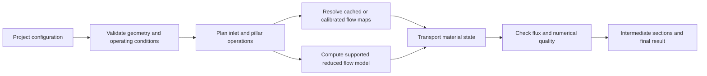

**Implementation plan for the reduced-order crossflow simulator**

Prepared 23 September 2026. Review baseline: commit `d69ab5f` (`init`). This is a proposed implementation plan, supported by isolated numerical experiments. Production solver files have not been changed.

**Decision: retain Python, replace the expensive algorithms, and use validated reusable flow maps.** Use NumPy and SciPy for numerical work, with an optional compiled kernel only if profiling later justifies it. A complete C++ port is not justified by this checkout or the measurements. The `cpp/` directory exists but is empty. Preserve it for a narrowly scoped extension if a later performance gate fails.

The central scientific deliverable is accurate serial-inlet curvature and asymmetric partial-height pillar deformation within an explicit range of operating conditions. Faster execution of the current heuristic model alone would not satisfy those goals.

The required repository layout is a frozen copy of the current `python/` tree at `legacy/python/`, with all new application and solver code under the root `src/` directory. Remove the original top-level `python/` folder after verifying that copy and updating its callers; it must not remain as a third implementation tree. The final application must include one dedicated **Solver comparison** view showing the old and new solver side by side, including results and measured performance. Other views may remain focused on the new solver. These requirements apply throughout the work packages below; this document update does not itself perform the migration.

**1. Scope, evidence, and assumptions**

The checkout contains eight nonempty Python package modules, two empty package modules (`simulator.py` and `__init__.py`), and six tests in two test files. No GUI implementation, runnable examples, reference CFD fields, calibration datasets, or existing C++ implementation were found. The README refers to examples and documentation that are absent. The six existing tests passed during review (`6 passed in 0.09s`).

Treat the user's tested right-triangle cases as useful project experience, but not yet as reproducible automated validation: no triangle or pillar tests are present in this checkout. If an existing GUI, examples, or reference data are supplied, integrate and preserve them before implementing replacements.

Working assumptions, pending project-specific clarification:

- Steady, laminar, miscible Newtonian liquids; rigid channels; isothermal operation.
- Support equal-property streams first, then explicitly validated viscosity contrasts. Store density and diffusivity, but only let them affect the model through mechanisms actually implemented.
- Prioritize low-Reynolds-number inlet sculpting and asymmetric partial-height pillars. Keep inertial models and their calibration separate.
- Windows is the initial desktop target. Python APIs remain usable without a GUI.
- Default results are cross-sections and material interfaces. Full 3D CFD is an offline reference/calibration tool, not the default interactive calculation.
- Conservation means volumetric material flux for incompressible constant-density transport. Unequal-density mixtures require a consistent mass/concentration formulation; simply changing a density value is not that formulation.

Immiscible interfaces, surface tension, contact angles, non-Newtonian rheology, curing kinetics, and channel deformation are separate extensions. Their inclusion would change both model scope and validation effort.

**2. What the literature contributes, and what remains unverified**

| Source | Verified relevance | Implementation consequence |
|---|---|---|
| [Zou et al., requested bioRxiv v1](https://www.biorxiv.org/content/10.1101/2025.10.27.684743v1), and [published article, *3D Hydrodynamic Flow Lithography*](https://advanced.onlinelibrary.wiley.com/doi/10.1002/adfm.77590) | Direct v1 access failed; the published version was accessible. It treats non-inertial inlet and partial-pillar sculpting, inlet-size effects, pillar interactions, and includes an added map-based forward model and GUI. Its flow simulations use one specified working-fluid composition. | Use it to select reference configurations, distinguish symmetry planes, and investigate reusable maps. Do not claim that its validation establishes arbitrary viscosity-ratio accuracy. Compare versions before reproducing exact v1 figures. |
| [Amini et al., *Engineering fluid flow using sequenced microstructures*](https://www.nature.com/articles/ncomms2841) | Inertial cylindrical-pillar deformations can be composed from precomputed transformations. Abstract and indexed article passages were accessible; direct publisher access varied. | Adopt the reusable-operator idea, while preserving its flow-condition and interaction limitations. Do not transfer inertial deformation strength to low-Re partial-height pillars. |
| [Stoecklein et al., *Optimization of micropillar sequences for fluid flow sculpting*](https://pubs.aip.org/aip/pof/article/28/1/012003/259950/Optimization-of-micropillar-sequences-for-fluid) | Validated streamline data are converted into sparse transition operators for fast forward simulation and sequence optimization. Independent composition assumes adequately separated pillars and matching flow conditions. | Build sparse/gather map application first; consider inverse design only after forward-model validation. Treat close pillar groups separately. |
| [Requested ScienceDirect article, PII S2095809921001429](https://www.sciencedirect.com/science/article/pii/S2095809921001429) | Access failed and exact-identifier searches did not resolve a title or DOI. | Bibliographic follow-up remains required. No physical or numerical claim in this plan is attributed to this unread paper. |
| [Additional relevant source: *FlowSculpt*, 2019](https://pubs.rsc.org/en/content/articlehtml/2019/lc/c9lc00658c) | The authors describe fast multi-material flow design and symmetry-breaking half-height pillars in an inertial-flow application. | Review its operator representation and interaction design as precedents; it does not supply low-Re validation for this solver. |

The architecture and numerical algorithms below are engineering proposals derived from the code review. The papers do not validate this repository's current surrogate operators. Published numerical datasets, if available with suitable reuse rights, should be assessed before paying to regenerate equivalent CFD cases.

**3. Repository findings that affect the implementation order**

Paths below describe the reviewed pre-migration checkout and are relative to the repository root. After the snapshot, the corresponding original files live under `legacy/python/`; fixes are implemented in `src/`, never in the frozen copy.

| Location | Finding | Required response |
|---|---|---|
| `python/src/crossflow_simulator/lubrication.py:163` | Pressure uses nested Python SOR loops and recomputes four face coefficients on every iteration. It accepts no physical grid spacings. | Replace with sparse assembly/solve; separately correct the discretization to use physical dimensions and consistent boundary fluxes. |
| `lubrication.py:252` | `velocity_from_pressure` computes `-k grad(p)` with `k = h^3`. That quantity is proportional to depth-integrated flux, not mean velocity. | Separate flux, gap height, average velocity, and reconstructed 3D velocity in names, units, and APIs. |
| `secondary_flow.py:602`, `:918` | Vertical forcing is derived from the divergence of that field, then normalized. A converged conservative depth-integrated flux should have zero divergence away from sources. | Do not treat discretization residuals as a physical vertical-flow model. Retain the existing operator only as an explicitly experimental baseline. |
| `secondary_flow.py:789` and related operators | Each step resamples integer labels; subpixel displacement can round to zero at every step. Velocity normalization also removes dependence on positive multiplicative strength. | Integrate floating-point coordinates and sample at the end. Replace arbitrary normalization with a physical or calibrated scale. |
| `physics.py:14` | A double Fourier sum recomputes trigonometric functions over an entire 2D mesh for every pair of modes. | Factor into one-dimensional basis matrices and matrix multiplications; cache profiles by geometry, grid, and tolerance. |
| `operators.py:137` | Auto stacking does not spatially sort serial/parallel inlets; it replaces user labels with consecutive labels. Its array branch ignores individual inlet flow rates. | Preserve stable material IDs and explicit physical inlet order. Represent each array inlet independently. |
| `inlets.py:35` | Array inference means variation in `y` and `z`, while a physical array can also mean multiple parallel ports at successive streamwise stations. A single inlet cannot be inferred. | Separate physical port topology from an explicitly prescribed cross-sectional pattern. Support a single inlet and reject ambiguous auto inference. |
| `operators.py:192` | Curvature depends on one aggregate diameter ratio and a column-wise integer roll with boundary replacement. There are no fluid properties or individual inlet diameters. | Replace with sequential inlet junction operators and flux-constrained interfaces. Do not tune the roll further. |
| `lubrication.py:518` | Polygon validation checks count, shape, and height, but not degeneracy, self-intersection, overlap, or resolution. | Add geometric and mesh-resolution checks before accepting a solve. Rasterization support is distinct from physics validation. |
| `lubrication.py:278` | Forward label deposition overwrites collisions, fills holes, uses zero as a missing-data marker, and may deposit a tracer that stopped before reaching the outlet. | Replace with donor maps or conservative remapping, and track invalid trajectories explicitly. |
| `plotter.py:21` | A fixed palette saturates beyond its small label range; normalized axes obscure physical aspect ratio. | Use stable material-color mapping and physical axes/aspect ratio. |
| `simulator.py`, tests, packaging | There is no application orchestrator. Tests cover only cross-section basics and 1D stacking. NumPy is unbounded despite use of `np.trapezoid`. | Introduce a configuration/result API, capability tests, reproducible dependencies, and correct Windows installation instructions. |

**4. Python-versus-C++ decision and the proof required**

The planning experiments are in [review/benchmark_review.py](review/benchmark_review.py), with raw measurements in [review/benchmark_results.json](review/benchmark_results.json). They do not modify production code.

The pressure experiment replaces the SOR loop with a SciPy sparse direct solve of the **same existing discrete equations**, including the current lack of physical grid-spacing factors. Assembly is included in the measured replacement time. Agreement proves numerical equivalence for that discrete problem; it does not establish physical correctness. The Fourier experiment rearranges the same 100-by-100 modal sum without reducing its term count.

| Experiment | Existing Python | Python with NumPy/SciPy reformulation | Observed kernel speedup | Numerical agreement |
|---|---:|---:|---:|---|
| Pressure, 41 x 31 grid | 1.498 s | 2.50 ms | 599x | Maximum pressure difference 7.57e-7 |
| Pressure, 81 x 61 grid | 21.486 s | 8.69 ms | 2474x | Maximum pressure difference 2.92e-6 |
| Velocity, 160 x 100 grid, 100 modes in each direction | 0.949 s | 0.843 ms | 1126x | Maximum normalized velocity difference 2.84e-14 |
| Velocity, 300 x 300 grid, 100 modes in each direction | 10.091 s | 1.832 ms | 5509x | Maximum normalized velocity difference 2.84e-14 |

The first three rows use medians of three sequential calls; the final row is a single spot measurement and should not be treated as a stable benchmark distribution. Tests ran on Windows 11, Python 3.13.12, NumPy 2.5.3, SciPy 1.18.1, with 16 logical CPUs reported. Thread counts and exact CPU model were not controlled/fully identified in this exploratory run. The sparse solve's relative residual was approximately 2–3e-15; legacy SOR stopped at its default update tolerance with approximately 2–3e-8 relative residual. No extra pressure accuracy was traded away for speed.

These measurements establish large improvements in two kernels, not a whole-application speedup, production-grid scalability, or the superiority of Python over an optimized C++ implementation. The expensive work can run in compiled numerical libraries without rewriting the application. That is sufficient evidence to choose the Python optimization path first.

The same review script reproduced additional correctness defects:

- Changing one array inlet's flow from 1 to 9 produced exactly the same output.
- Input labels `[10, 20, 30, 40]` became `[10, 11, 12, 13]`.
- A localized secondary-flow case changed 2.19% of pixels with 20 steps, but changed zero pixels with 120 or 240 steps. Repeated nearest-neighbor rounding erased the motion.
- Changing positive vortex strength from 0.01 to 0.5 produced identical labels when velocity normalization was enabled.

Reproduction of the historical review in the current pre-migration checkout, using a dedicated environment:

```powershell
python -m venv .review-venv
.\.review-venv\Scripts\python.exe -m pip install numpy==2.5.3 scipy==1.18.1 pytest==9.1.1
.\.review-venv\Scripts\python.exe docs/review/benchmark_review.py
$env:PYTHONPATH = (Join-Path (Get-Location) 'python/src')
.\.review-venv\Scripts\python.exe -m pytest python/tests -q -p no:cacheprovider
```

During migration, update the review harness to explicitly select `legacy/python/src` and run legacy tests from `legacy/python/tests`. Preserve the recorded JSON as historical measurements. New application benchmarks live under root `benchmarks/` and exercise both isolated solver backends; they must never accidentally import the new package when measuring legacy behavior.

Recommended stack:

- Python for configuration, orchestration, calibration, file formats, and GUI.
- NumPy for basis evaluation, map composition/application, and array operations.
- SciPy sparse solvers for pressure and variable-viscosity cross-sectional solves.
- Optional Numba or a small C++ extension only after profiling identifies a remaining Python loop worth compiling. Do not make either an initial mandatory dependency.
- PySide6 for a desktop GUI if no existing GUI is recovered. Retain Matplotlib for publication-quality exports; benchmark raster display before adding another rendering dependency.

SciPy provides [sparse direct solves](https://docs.scipy.org/doc/scipy/reference/generated/scipy.sparse.linalg.spsolve.html) and [reusable factorizations](https://docs.scipy.org/doc/scipy/reference/generated/scipy.sparse.linalg.factorized.html). [Conjugate gradient](https://docs.scipy.org/doc/scipy/reference/generated/scipy.sparse.linalg.cg.html) is a later candidate only for a correctly constructed symmetric positive-definite system and compatible preconditioner.

The decision gate after optimization is explicit:

1. Profile complete representative runs, separating geometry, pressure, map construction, transport, and rendering.
2. Require a substantial end-to-end improvement at equal accuracy, with a target of at least 10x on cases dominated by the legacy pressure/Fourier work. Do not apply that promise to workloads where those kernels are absent.
3. Target cached 300 x 300 cross-section map updates below 100 ms, normal interactive results below one second where a validated map exists, and fresh reduced-model calculations below two seconds on the agreed reference PC. These are acceptance targets, not current measurements.
4. If a compute kernel still consumes over 40% of total runtime and misses the target, prototype that one kernel with compilation. Include data conversion, startup, and transfer overhead in comparisons.
5. Adopt a C++ kernel only if it brings at least a further 2x end-to-end gain on the failing workload, preserves validation results, and can ship reproducible Windows wheels. Use a narrow array interface; keep GUI and scientific orchestration in Python.

Report cold start, first solve, repeated solve, and cached update separately. Record CPU, versions, thread count, grid sizes, tolerances, memory, numerical error, and trial distributions. Kernel speedups do not multiply into an application speedup. The planning benchmark is intentionally small and is not a complete scaling or memory study.

**5. Target architecture and data contracts**

Use a single application service from both command line and GUI:



Proposed contracts:

| Object | Essential information |
|---|---|
| `ChannelGeometry` | Physical dimensions, stations, cross-sectional shape, outlet transition, and units. |
| `FluidProperties` | Stable ID, viscosity, density, optional diffusivity, temperature/reference condition, and supported constitutive model. |
| `InletSpec` | Stable ID, material ID, physical port position, diameter/shape, normal/orientation, station order, imposed flow or pressure, and optional tubing resistance. |
| `PillarSpec` | Validated footprint vertices, physical placement, extrusion height, top/bottom mount, rotation, and optional group ID. |
| `OperatingConditions` | Boundary condition type, flow rates or pressure network, characteristic scales, Reynolds number definition, and diffusion setting. |
| `GridSpec` | Separate flow-grid and output-grid resolutions, physical coordinates, centering convention, refinement controls, and dtype. |
| `FlowSolution` | Pressure, face-integrated fluxes, optional mean/3D velocity, residuals, mass balance, convergence flag, timings, and model provenance. |
| `TransportMap` | Source/destination geometry, continuous donor coordinates or sparse flux weights, origin inlet for injection, validity envelope, and version. |
| `MaterialState` | Material IDs plus concentrations/flux fractions as needed; labels are a visualization product, not the sole conservation variable. |
| `SimulationResult` | Config snapshot, intermediate sections, final section, interface curves, diagnostics, timings, and input/model hashes. |
| `SolverBackend` | Solver identity/version, supported capabilities, config conversion, isolated worker entry point, cancellation, and normalized result export. |
| `ComparisonResult` | Shared input hash, both effective solver configurations, legacy snapshot hash, run IDs/statuses, timings/cache state, aligned results, and comparison metrics. |

Use SI units internally and convert only at input/output. Keep `x` streamwise, `y` lateral, and `z` vertical everywhere. Record whether a field is stored as `[y, x]` or `[z, y]`. Define array shapes in APIs and validate them.

Default to cell-centered finite-volume flow fields for the corrected pressure solver. Keep explicit adapters for the current wall-inclusive cross-section grid rather than silently reinterpreting saved arrays. Store geometric cell areas and axial flux weights.

Store project configuration as versioned JSON. Store numerical arrays in compressed NPZ initially, with explicit dtype/shape/schema checks and no pickled objects. Use chunked storage only when datasets actually require it. Include units, solver/model version, calibration source, and validity range in every exported result.

A cached flow map is reusable across material recoloring only when material labels do not alter the velocity field. Viscosity changes, active concentration coupling, geometry changes, changed inlet flux ratios, or changed interaction groups must invalidate the relevant maps. Reusing a factorization is narrower still: the matrix and boundary-condition structure must remain unchanged.

**Preserving and executing the original solver.** Before new development, copy the current `python/` tree into `legacy/python/` and record its source revision, file hashes, and dependency/runtime information in `legacy/manifest.json`. Verify the copy, redirect runners/tests/build configuration/documentation to the appropriate legacy or new paths, and then delete the original top-level `python/` directory. Check that no executable configuration still depends on that removed path; historical audit references may retain it when clearly identified. The final layout has one preserved legacy copy and one new implementation. Preserve original source, tests, and behavior, including known defects. Exclude transient environments/caches from execution and record any archival exclusions. No new development or numerical fixes go into `legacy/python/`.

Place all compatibility code in `src/crossflow_simulator/backends/`. Because the original and new packages can share the name `crossflow_simulator`, run them in separate processes with explicit import paths and independently reproducible environments. The legacy worker loads only the frozen package; the new worker loads only root `src/`. Exchange versioned configuration/result files or messages, and assert each worker's loaded source path and solver identity. Do not switch `sys.path` between implementations in a shared interpreter.

The legacy adapter must explicitly assemble the original operator sequence because its `simulator.py` is empty. Verify that sequence against captured baseline cases. Input conversion and result normalization must not replace legacy numerical operations with corrected ones. Display material-color remapping, if needed, must retain the raw IDs and expose original label defects in diagnostics.

Ship the legacy worker and its required assets in the final application, with a clean-machine comparison smoke test. A source checkout or development environment must not be required to use the comparison view. Keep backend-specific dependencies isolated where they cannot share a compatible runtime.

**6. Work package A — reproducible baseline and numerical correctness**

Priority P0. Estimated effort: 4–6 engineering days. This precedes performance acceptance and model fitting.

1. Recover or explicitly archive any existing external demos/GUI and the user's successful right-triangle setups as project files.
2. Create and verify the `legacy/python/` snapshot and manifest before any source refactoring. Add the new headless runner in `src/crossflow_simulator/simulator.py`, plus an external legacy adapter that executes original operators without modifying them.
3. Create representative cases: empty rectangular channel; three serial inlets; unequal parallel inlets; unequal 2 x 2 array; off-center bottom-mounted right triangle; its reflected and top-mounted variants; two nearby pillars.
4. Record the current output and timings as **legacy behavior**, not truth. Use analytical solutions and external reference fields for accuracy checks.
5. Add targeted tests for the demonstrated array-flow/label defects, pressure spacing, material flux, coordinate conventions, and advection-step dependence.
6. Replace print-only convergence warnings with structured status and an exception or explicit failed result at application boundaries. Failed solves must not appear as successful predictions.
7. Repair package installation instructions, add compatible dependency bounds and a reproducible development environment, and ensure the runner works from a clean install.

Exit criteria: verified legacy snapshot; original top-level `python/` directory removed; isolated old/new CLI runs; all six original tests pass against the frozen implementation; each known defect has a failing regression case or a documented replacement specification for the new solver; baseline timings and quality metrics are stored together. Automated checks detect accidental changes to archived source, incorrect backend imports, and runtime references to the removed directory.

**7. Work package B — make the existing calculations efficient**

Priority P0. Estimated effort: 5–8 engineering days, with benchmarking throughout.

**B1. Rectangular-channel velocity.** Write the same truncated solution as `U = S_z @ C.T @ S_y.T`, where each sine basis is evaluated once. Normalize using the same quadrature. Cache by aspect ratio, coordinates, modal tolerance, and normalization convention. After equivalence is established, consider an adaptive mode count or an alternative stable single-series representation, with aspect-ratio and wall-error tests. Do not lower modal accuracy just to claim a speedup.

**B2. Conservative pressure solve.** Assemble a finite-volume system from face transmissibilities. Include physical face areas, center distances, and separate `dx`/`dy`; use harmonic transmissibilities across discontinuous conductance where appropriate. Apply zero normal boundary flux directly. Eliminate prescribed-pressure unknowns consistently rather than destroying matrix symmetry through arbitrary boundary rows.

Use `spsolve` first for the ordinary grids. Benchmark factorization reuse for unchanged conductance and repeated boundary values. For larger grids or high height ratios, compare iterative methods/preconditioners against the direct reference and report convergence as well as runtime. Do not assume a generic ILU preconditioner is valid for CG.

**B3. Separate the physical quantities.** For a local lubrication gap `h` and constant viscosity across that gap, use the dimensional relationship `q = -(h^3 / (12 mu)) grad(p)` for depth-integrated flux and `u_mean = q / h`. If viscosity varies through the gap, derive the layered mobility or solve the appropriate cross-sectional problem; inserting an arbitrary averaged viscosity is not generally equivalent.

Compute pressure-solve and conservation diagnostics from the same face fluxes used in assembly. A separate centered gradient can be used for display, but must not be mistaken for the conservative numerical flux. Use a normalized algebraic residual plus inlet/outlet flux imbalance as convergence criteria.

**B4. Remove redundant work.** Reuse immutable grid coordinates and mesh arrays; avoid unnecessary `CrossSection.copy()` allocations; preallocate transport buffers; cache rasterized geometry and pressure operators; recompute only the suffix of an operator sequence affected by an edit. Apply an explicit memory budget and least-recently-used eviction to caches.

**B5. Benchmark real workloads.** Use small, medium, and high resolutions, several pillar heights, and 1/5/10-operator cases. Bound BLAS threading when running independent parameter sweeps to avoid oversubscription. Add performance checks that allow ordinary system noise but catch large regressions.

Exit criteria: corrected analytical pressure cases pass; optimized Fourier results agree to floating-point tolerance; measured end-to-end improvement meets the agreed target or triggers the narrow compiled-kernel gate. Report that physical corrections intentionally change some legacy outputs.

**8. Work package C — transport and reusable maps**

Priority P0; prerequisite for both scientific goals. Estimated effort: 5–8 engineering days.

1. Integrate floating-point donor coordinates using at least midpoint/RK2 integration and velocity interpolation. Sample the original material field only at the completed map, not after every substep.
2. Use real residence time or `dy/dx = v/u`, `dz/dx = w/u` only where streamwise velocity is positive and bounded away from zero. Explicitly handle stagnation, walls, recirculation, and trajectories that fail to reach the target plane. Never silently clamp a physically invalid trajectory into a valid result.
3. Keep nearest-neighbor sampling available for categorical preview. Use material fractions and a conservative transport/remap mode for validated quantitative results. Never interpolate numerical material IDs as scalar concentrations.
4. Distinguish conservation of axial flux from conservation of cross-sectional area. For inlet-to-outlet mapping `T`, enforce the discrete counterpart of `u_out(T(a)) det(DT(a)) = u_in(a)` in a steady incompressible, source-free operator. Interfaces can change area while conserving material flow.
5. Provide diagnostic checks for map orientation/folding, flux balance, wall crossing, and loss of thin material regions. A generic 2D divergence-free vortex does not by itself guarantee a correct flux-preserving 3D flow map.
6. Cache continuous maps and their interpolation weights. For quantitative conservative maps, use sparse weights acting on cell flux/material amounts; enforce nonnegative transfer weights and source accounting. For preview, a donor-coordinate gather may suffice.
7. Compose maps with the correct direction/order. Verify `A then B` on a known deformation. Compare whole-map composition with sequential application, since interpolation error accumulates differently. At diffusion steps or material-coupled flow updates, keep the necessary intermediate state.
8. Avoid dense transition matrices. At 300 x 300 pixels a dense square float64 matrix requires about 64.8 GB; sparse local weights or coordinate maps are the appropriate representation.

Exit criteria: a subpixel motion accumulates rather than freezing; increasing integration resolution produces convergence; material flux stays within the set tolerance; zero forcing is identity; constant material stays constant; serial and composed reference maps agree within their numerical error budget.

**9. Work package D — serial-inlet curvature and fluid properties**

Priority P1, after the shared P0 foundation. Estimated software effort: 8–12 engineering days. Reference-data generation is additional.

**D1. Model actual sequential injection.** A serial inlet changes total downstream flow and introduces a new material. Represent each junction at its physical `x` station, in a specified mounting/orientation. Sort only when physical station order is unambiguous; preserve stable IDs. Sum diameters only for ports in the same relevant station, rather than combining every serial port into one global ratio.

The junction operator needs two source domains: the upstream cross-section and the new inlet. Its outgoing donor/origin map identifies which source supplied each outgoing material element. Enforce `Q_after = Q_before + Q_inlet`. This cannot be represented by simply deforming existing labels.

**D2. Establish a minimal calibrated parameterization.** Include `D_i/W`, `H/W`, lateral inlet offset, inlet-to-channel orientation, `Q_i/Q_upstream`, station spacing, viscosity ratios where supported, and Reynolds number. Account for downstream transition geometry if the reference observation plane lies beyond a contraction. Separate single-inlet filling from subsequent inlet addition.

**D3. Build a controlled same-property reference set.** Begin with two inlets, then validate three and five. Vary small/equal/large port-to-channel ratios, centered/off-center placement, aspect ratio, and unequal flow splits. Use 24–40 deliberately selected baseline configurations plus separate holdouts rather than a huge tensor grid. Add cases where the model's uncertainty or error is greatest.

**D4. Replace the curvature roll.** Prefer CFD-derived junction maps where available. As a compact alternative for unfolded layers, fit interface curves in a small smooth basis, with coefficients dependent on the physical parameters. Solve offsets/thicknesses under the flux constraints

`Q_i = integral_over_region_i u_x(y,z) dA`.

Constrain layer ordering and nonnegative thickness. Do not independently shift every interface and then clip at a wall. When an interface folds or ceases to be single-valued, switch to the full material-map representation rather than forcing a `z(y)` curve.

**D5. Add variable viscosity correctly.** For a fully developed cross-section, a useful reduced subproblem is `div_yz(mu(y,z) grad_yz(u_x)) = -G`, with no-slip boundaries and a common pressure gradient. This determines local mobility and flux partitioning; it is not a complete model of the 3D injection junction.

For viscosity contrasts, couple this subproblem to interface updates and use viscosity-aware junction reference data or a calibrated correction. Check convergence of the coupling. A frozen equal-property map must not be advertised as a validated arbitrary-viscosity solver. Start with a bounded viscosity-ratio range supported by data; use log-spaced calibration points and report interpolation limits.

**D6. Treat density and diffusivity with their actual roles.** In a constant-property creeping-flow model without buoyancy, changing the common viscosity at fixed flow scales pressure, and changing common density does not create a new streamline shape. Include these invariance tests. Finite inertia, buoyancy from density differences, or concentration-dependent density requires a separately validated model. Offer optional scalar diffusion only after defining concentration variables and residence time.

**D7. Distinguish driving conditions.** Under prescribed flow rates, the port diameter affects entrance geometry while total flux remains imposed. Under prescribed pressures, tubing and port resistances can change flow ratios. Add a small hydraulic-network solve before junction transport for the latter mode. Reject inconsistent over-specified boundary conditions.

Output metrics: interface position, signed centerline curvature, layer thickness versus lateral location, each material's axial flux fraction, pressure drop, and validity range. Evaluate physical curvature using physical coordinates, not raw normalized pixels.

Exit criteria: held-out same-property cases meet the interface/flux targets; viscosity-dependent results meet their own held-out targets within the published supported range; invariance tests pass; equal summed diameters with different serial port arrangements can produce distinct outcomes when reference data require them.

**10. Work package E — array inlets and asymmetric partial-height pillars**

Priority P1. Estimated software effort: 8–12 engineering days; additional reference-data work is essential.

**E1. Repair the initial state.** Explicitly support two workflows: a prescribed array of incoming cross-sectional material patches, and a physical sequence of port rows/junctions. Do not infer one from the other. For physical arrays, use the junction pipeline. For prescribed patterns, preserve every inlet's label and specified flux.

Independent row/column totals are insufficient for a general non-separable matrix of inlet flows. If a simple rectangular partition cannot match all prescribed fluxes under the velocity field, solve a constrained partition, allow curved boundaries, or require physical junction maps. Do not silently substitute equal cells.

**E2. Make asymmetric geometry explicit.** Use a general polygon footprint extruded from the bottom or top. Keep the entire cross-section; do not impose top-bottom or lateral symmetry to save time on asymmetric configurations. Derive directed edges and normals consistently from the polygon; do not choose an arbitrary diagonal as its physical driving slope.

Geometry validation must cover finite coordinates, nonzero area, repeated points, winding, self-intersection, channel intersection, overlap semantics, wall contact, and minimum resolved gap. Define whether touching/overlapping pillars form one composite solid or are rejected. Handle full blockage explicitly. The full-height limit is outside an everywhere-positive gap model and needs obstacle cells or a different reference/map model.

**E3. Promote a map-based model as the validated prediction path.** Generate or import 3D Stokes/Navier–Stokes reference velocity fields for selected geometries. Trace particles to inlet/outlet planes and build continuous or conservative maps. Store aspect ratio, Reynolds number, pillar height, offset, vertices, mount, boundary conditions, station distances, and reference mesh convergence.

Lubrication can be retained as a cheap exploratory pressure/flow approximation where its aspect-ratio and geometric assumptions are justified. Abrupt partial-height steps and square channels do not automatically satisfy those assumptions. A faster pressure solver cannot recover missing 3D physics by itself.

**E4. Retire residual-driven deformation.** If a reduced 3D reconstruction is investigated, recover transverse velocity through continuity with consistent axial/lateral velocity and solid-boundary conditions. Validate it independently. Do not normalize `div(q)` into a vortex-strength signal; that can amplify numerical inconsistency as the pressure solve converges. For geometries where the reconstruction fails, use validated reference maps and expose unsupported cases honestly.

**E5. Validate shape families gradually.** Begin with the previously explored right triangle, but include off-center placement, top/bottom mounting, streamwise reversal, several heights, and different aspect ratios. Then add scalene triangles, trapezoids, rectangles, and selected concave polygons. General polygon drawing support must not imply validated predictions for every polygon.

**E6. Use symmetry and reversibility as tests.** Reflect both geometry and incoming state for lateral/top-bottom equivariance checks. For a steady creeping-flow reference case, reversing all driving conditions should recover inverse streamline mappings where diffusion and numerical errors permit. Include fore-aft symmetric zero-net-deformation controls appropriate to the geometry. Do not apply those controls indiscriminately at finite inertia or to partially developed inlet fields.

**E7. Handle interactions.** Compare two-pillar reference solutions with composed isolated-pillar maps over several spacings. Select the minimum independent-composition spacing from an error threshold for that family and operating condition. For smaller separations, use a group map or coupled-domain solve. Do not copy a spacing threshold from a different pillar type/regime. Include nonidentical neighboring pillars and interactions with a nearby inlet or contraction.

Exit criteria: asymmetric displacement direction, magnitude, and interface shape pass held-out tests; reflected cases transform correctly; material flux is conserved; arbitrary polygon import is clearly distinguished from calibrated geometric families; close-pillar behavior is validated or explicitly outside the supported range.

**Physics improvements and their runtime costs.** Correct grid metrics, dimensional flux semantics, stable material IDs, and physical parameter scaling have little additional online cost after sparse assembly and caching. A validated replacement map can improve predictions at approximately the same application cost as an existing map. Continuous coordinate integration removes a numerical failure but may require more arithmetic per trajectory; map reuse amortizes that cost. Variable-viscosity coupling, diffusion, and new coupled-pillar solves can add real runtime. Keep their online costs visible and accept them only within the relevant mode's measured budget. Offline CFD/library generation is a separate, potentially substantial cost and must never be hidden inside a claim of free accuracy improvement.

**11. Work package F — GUI and usability**

Priority P1 for a usable shell and the mandatory comparison view, P2 for advanced tools. Estimated effort: 11–17 engineering days, after the project/result contracts stabilize.

If the missing GUI is recovered, audit it against the following requirements and preserve working interactions. Otherwise build a PySide6 desktop application. Qt supports [asynchronous subprocess communication through QProcess](https://doc.qt.io/qtforpython-6.8/PySide6/QtCore/QProcess.html); the solver should not run on the GUI event loop.

The main workflow is: choose a template, set channel and materials, configure inlets, place pillars, preview, run a validated calculation, compare, and export.

| Area | Concrete implementation |
|---|---|
| Project setup | Templates for serial, parallel, array, and asymmetric-pillar examples; visible units; editable names; save/load and autosave recovery. |
| Geometry editor | Top and side views; draggable pillars/ports; numerical coordinate fields; grid snapping; rotate/reflect/duplicate; top/bottom mount; polygon vertex editor; inline invalid-geometry feedback. |
| Material/inlet table | Stable material colors and IDs; diameter, location, flow/pressure, viscosity, density; explicit inlet order; linked unit conversion; summary of total flow and ratios. |
| Operator sequence | Drag to reorder; enable/disable; display insertion station; preserve undo/redo; show intermediate cross-sections; invalidate only downstream results. |
| Result view | Input/output comparison, cross-section station slider, physical axes, interface overlays, selectable material visibility, difference/IoU overlays against a reference. |
| Solver comparison view | One dedicated tab/view with **Legacy solver** on the left and **New solver** on the right; shared case controls, synchronized physical axes/station/zoom and material colors; result images and performance metrics visible together. Other views need not duplicate this layout. |
| Execution | Quick preview and validated modes with clear scope; progress by computational stage; cancel; estimated cost based on prior runs; preserve last successful result. |
| Diagnostics | Convergence, flux imbalance, model validity, resolution, and pressure drop adjacent to results; detailed solver settings under an advanced panel. |
| Reproducibility | Export config plus numerical arrays and figures; store model/calibration versions and computation settings; label results stale when inputs change. |

Use persistent isolated worker processes for the new and legacy backends to avoid repeated startup overhead. Start the legacy worker only when comparison is requested. Submit immutable configuration snapshots with monotonically increasing job IDs and a shared comparison ID for paired runs. Debounce rapid edits, cancel superseded requests, and discard late results with an older job ID. Use cooperative cancellation between stages; terminate/restart a worker only when a blocked numerical call cannot be interrupted safely. Do not modify GUI widgets from solver processes.

**Comparison interaction and metrics.** A **Run both** action sends the same physical case to each backend through explicit adapters. Show the effective settings for each solver, including grid, tolerance, model, and unsupported parameters. Use common physical observation planes and shared material identities. Regrid only for display/metrics when necessary, identify that operation, and preserve both native outputs. Provide an optional difference overlay with per-material IoU, interface distance, flux fractions, and available pressure/convergence diagnostics. Agreement with legacy is a behavioral comparison, not proof of physical accuracy; external-reference validation remains separate.

Each pane displays status, solve time, end-to-end backend time, available stage timings, and peak worker memory when supported by the platform. Report startup and rendering separately. Mark diagnostics unavailable rather than inventing values that legacy does not return. Show speedup as `legacy_time / new_time` only for successful comparable runs with the same timing scope; memory statistics need a stated measurement method and cannot compare a process-lifetime peak against a per-run peak.

Provide a quick paired run and a repeatable benchmark action. Execute measured backends sequentially to avoid resource contention, use the same thread/resource limits where applicable, and alternate their order across repeated trials. Benchmark cold, warm, and cached execution separately; default to uncached computation in already-started workers for the solve-time comparison. Report trial count, median and spread, cache hits, and effective grid/tolerance differences. Do not label a cached lookup versus a fresh legacy solve as an algorithmic speedup. Distinguish matched-setting comparisons from separately established equal-accuracy performance comparisons.

Legacy can be much slower: keep the new result visible as it finishes, show progress for the pending side, and support cancel/timeout per backend. A failed, unsupported, or cancelled legacy run must not hide a successful new result or produce a speedup number. Where only the new solver supports a case, show **Not supported by legacy** with the reason; never silently drop fluid properties or simplify geometry. Ship shared-capability presets so users can immediately run a complete comparison.

Exports must include both native results, a side-by-side figure, numerical differences, timings, benchmark protocol, both effective configurations, and backend/snapshot versions. Editing the case marks both results stale; a pair is current only when both results match the same comparison ID and input snapshot. Keep this view available in the final release; comparison is not merely a development benchmark.

Keep large arrays out of frequent JSON messages; initially use result files or shared memory when profiling warrants it. Rate-limit progress updates. A color-only edit should require no pressure or trajectory calculation. A flow change with active viscosity coupling must perform the required recomputation.

GUI acceptance: launch and load a sample without code edits; no event-loop stalls during normal calculation; rapid slider changes cannot display stale results; cancel preserves the last good output; project save/load reproduces parameters and material colors; physical aspect ratio and units are correct; more than eight materials remain distinguishable; keyboard navigation and high-DPI display work. On a clean installation, open Solver comparison, run a shipped shared-capability case, inspect both results and runtime values, and export the paired report. Other views remain independently usable.

**12. Verification, calibration, and release gates**

Use a validation pyramid: analytical limits, numerical convergence, independent CFD, then experiment. Screenshot similarity and current-code agreement are insufficient on their own.

| Area | Test cases | Proposed initial acceptance target |
|---|---|---|
| Pressure | Constant gap; manufactured variable conductance; rectangular physical domains; discontinuous conductance; zero flow | Relative algebraic residual <= 1e-8 where scaled appropriately; normalized inlet/outlet imbalance <= 1e-6; observed convergence under refinement. |
| Rectangular velocity | Several aspect ratios, mean-flow normalization, no-slip walls, comparison to legacy modal sum | Optimized equivalent formula differs by <= 1e-10 for the tested normalized cases; truncation error assessed separately. |
| Material flux | Unequal inlets, multiple labels, repeated maps, viscosity contrast | Per-material flux-fraction error <= 0.5 percentage points against the specified/reference flux; tighter target for simple cases. |
| Transport | Subpixel displacement; known smooth map; reversed map; step refinement; zero deformation | Increasing integration accuracy does not freeze transport; error converges; no unexplained invalid trajectories. |
| Serial curvature | Centered/off-center ports, diameter/flow ratios, aspect ratios, withheld fluid ratios | Initial target: mean interface-distance error <= 2% of channel height and per-material IoU >= 0.90 for adequately resolved regions. |
| Pillar deformation | Off-center right triangles, height/mount variations, reflected cases, held-out polygons | Initial target: normalized RMS displacement error <= 5% of the smaller cross-section dimension, plus interface/flux targets. |
| Pillar interactions | Coupled vs composed reference solutions across spacing | Independence allowed only where added composition error stays within its allocated budget. |
| GUI | Edit/run/cancel races, restart worker, save/load, invalid config, unit changes | No stale result shown as current; correct recovery; exact configuration round trip. |
| Legacy preservation | Snapshot hashes, original tests, captured operator sequences, worker import paths | Archived numerical source remains unchanged; legacy worker loads only archived code; captured baseline outputs are reproduced under the recorded environment. |
| Solver comparison | Same-input paired runs, unequal runtimes, failure/cancel/timeout, unsupported inputs, cache modes, packaged launch | Correct pane/backend identity; synchronized coordinates and colors; no mismatched input pairs or misleading speedups; paired result/performance export works without a development checkout. |
| Performance | Cold/warm/cached cases with matched accuracy, varied grids and sequence lengths | Meet the budgets in part 4 or document and resolve the remaining bottleneck before release. |

These thresholds are proposed engineering gates, not already demonstrated accuracy. Set final thresholds using reference mesh uncertainty, experimental resolution, and the application's minimum meaningful feature size. IoU is misleading for very thin regions; include contour distance, centroid displacement, topology, and flux. Measure signed curvature on smoothed physical interface coordinates with a recorded smoothing scale; curvature is especially sensitive to raster noise.

For every CFD reference, store the physical domain and observation planes, geometry and boundary conditions, fluid parameters, solver tolerances, mesh convergence, coordinate orientation, and source/license. Split training and validation by complete geometry/operating-condition families; adjacent images from one CFD case must not appear on both sides. Fit to velocity/displacement/interface data where possible, not just final colored images.

Compare equivalent observation planes. An inlet plane, a post-pillar plane, and a contracted outlet can have different cross-sectional shapes. Experimental cured-particle outlines can also include curing, diffusion, shrinkage, or imaging effects and should not be treated as exact streamline maps.

Each validated model has a machine-readable envelope and independent error report. Interpolation inside that envelope is permitted after validation; extrapolation is explicitly experimental. A failed physical-validation gate leads to better reference data or a different reduced model, not more arbitrary strength parameters.

**13. Useful additional features, ordered by value**

| Feature | Priority and cost | Dependency and benefit |
|---|---|---|
| Parameter sweeps with comparison gallery and CSV export | P2, 2–4 days | Reuses headless runner and caching; directly helps study inlet size, fluid ratios, and pillar height. |
| Experimental/CFD image import and alignment | P2, 2–4 days | Known pixel scale and plane metadata; accelerates quantitative validation. Preserve registration uncertainty. |
| Interface/flux/pressure plots | P1/P2, 2–3 days | Derived from result diagnostics; makes parameter changes interpretable. |
| Sensitivity and uncertainty bands | P2, 3–5 days | Requires validated parameter range; prioritize finite-difference/ensemble analysis before elaborate surrogates. |
| Target-shape optimization | P3, 5–10 days | Only after fast validated forward maps. Start with bounded search over supported operators; combine shape error, pressure cost, and sequence length. Confirm finalists with independent reference solves. |
| Outlet transitions and photomask preview | P3, separate scoped iteration | Useful for lithography. Require transition maps and label geometric previews separately from a curing-physics simulation. |
| Diffusion-aware concentration views | P3, 4–8 days plus validation | Requires diffusivities, residence time, conservative species transport, and checks that added online cost stays within budget. |
| GPU acceleration/full C++ rewrite | Deferred | No present evidence of necessity. Reconsider only from measured workloads after algorithmic work. |

Avoid adding inverse design, complex 3D rendering, or new constitutive physics before the primary inlet/pillar predictions and performance gates pass.

**14. File-level implementation map**

First establish the frozen snapshot and baseline verification, then develop the replacement under root `src/`. The intended layout is:

```text
legacy/
  manifest.json
  python/                         # Preserved copy of the current python tree
    pyproject.toml
    requirements.txt
    README.md
    src/crossflow_simulator/
    tests/
src/
  crossflow_simulator/             # All new solver, GUI, and adapter code
    backends/                     # New backend and isolated legacy worker adapter
    comparison.py                 # Paired execution, metrics, timing, export
    gui/
tests/                            # New solver and comparison integration tests
benchmarks/                       # Repeatable comparisons of both backends
examples/                         # Shared-capability and new-solver project files
reference_data/                   # Metadata and small validation fixtures
docs/
pyproject.toml                    # New application packaging, configured for src/
cpp/                              # Reserved for an optional future compiled kernel
```

`legacy/` and `src/` are the two implementation roots. The original root-level `python/` folder is removed in M0 after snapshot verification and path migration. Supporting tests, documentation, and data remain separate. New adapters live in `src/`; the original package's internal `legacy/python/src/` is retained as part of the archived copy. Update entry points, package discovery, CI, and example paths during migration, and prevent build tools from accidentally including legacy modules in the new package namespace.

| New path under `src/crossflow_simulator/` | Planned responsibility |
|---|---|
| `simulator.py` | Public `simulate(config, progress, cancellation)` orchestration; stage selection; timing; result construction. |
| `backends/legacy.py`, `backends/legacy_worker.py`, `backends/new.py` | Capability checks, isolated execution, explicit configuration conversion, and backend identity. Legacy numerical code stays in `legacy/python/`. |
| `comparison.py` | Shared-input paired runs, comparable timing scopes, result alignment, difference metrics, and paired exports. |
| `config.py`, `results.py`, `materials.py` | Typed configuration, units, versioned serialization, fluids, diagnostics, and result contracts. |
| `inlets.py`, `operators.py` | Explicit port topology and ordering; stable labels; legacy adapters; corrected prescribed-pattern initialization. |
| `physics.py` | Fast rectangular-channel profile, scaling, nondimensional groups, and flux integration. |
| `geometry.py` | Polygon validation, physical placement, mounts, grouping, rasterization, and geometry hashes. |
| `pressure.py` or a small `solvers/` package | Sparse finite-volume pressure, dimensional conductance, residuals, consistent face flux, optional variable-viscosity solve. |
| `transport.py`, `maps.py` | Coordinate integration, origin-aware injection maps, conservative remapping, composition, validity checks. |
| `models/serial_inlet.py`, `models/partial_pillar.py` | Validated physical parameterizations and model selection; clear separation from legacy surrogates. |
| `calibration.py`, `cache.py` | Reference import, fit/holdout reports, versioned bounded caches, and invalidation. |
| `secondary_flow.py`, `pillars.py`, `lubrication.py` where needed | New implementations of accepted functionality, with compatibility at the adapter boundary. Keep original heuristic implementations unchanged in `legacy/python/`. |
| `gui/`, `plotter.py` | Desktop application/controller/worker communication; material colors, physical plotting, and exports. |
| `cli.py`, `__main__.py` | Headless run, benchmark, batch sweep, and validation commands. |

Add root `tests/` coverage by behavior, `benchmarks/` for long-lived performance cases, `examples/` for reproducible configurations, and `reference_data/` metadata/small fixtures with large data stored separately. Original tests remain in `legacy/python/tests/` and run in the legacy environment. Keep current review experiments in `docs/review/` as the record of this planning decision, adapting only their source-selection plumbing when the snapshot moves.

**15. Delivery order, effort, and concrete completion conditions**

| Milestone | Deliverable | Dependencies | Estimated engineering effort |
|---|---|---|---|
| M0 | Verify `legacy/python/` snapshot; establish new `src/` layout, isolated backends, baseline runner and tests; remove original root `python/` after path migration | Existing checkout; existing user cases if available | 4–6 days |
| M1 | Sparse pressure, fast profile, caching, performance report | M0 | 5–8 days |
| M2 | Continuous/conservative transport and reusable maps | M0; integrates with M1 | 5–8 days |
| M3 | Validated serial inlet curvature and bounded fluid-property support | M1/M2 plus reference data | 8–12 days |
| M4 | Validated asymmetric partial-height pillar/array behavior | M1/M2 plus reference data | 8–12 days |
| M5 | Usable GUI including mandatory side-by-side solver comparison, paired reports, persistence, isolated workers | Stable configuration/result/map APIs and both backends | 11–17 days |
| M6 | Integrated validation, packaged legacy/new execution, documentation, comparison presets | M3/M4/M5 | 5–8 days |

Total estimated software effort is 46–71 engineering days, roughly 9–15 full-time weeks for one experienced developer, **excluding substantial new CFD/experimental data generation and model research**. This includes preserving and shipping the legacy solver and the required comparison view. Equal-property functionality can be delivered earlier. Unequal-fluid validation or novel polygon families may extend the research schedule significantly. These are planning estimates, not commitments.

Reference-data preparation should begin during M0; otherwise it will block M3/M4 regardless of coding speed. The GUI shell can start once configuration contracts stabilize, but its advanced controls should follow supported physics. Optional features are separate from these estimates.

Suggested reviewable change sequence:

1. Verified legacy snapshot, new `src/` packaging, isolated backend adapters, baseline fixtures, and numerical defect regressions for the replacement.
2. Fourier algebra optimization with equivalence benchmark.
3. Sparse pressure backend, followed by a separately reviewed spacing/flux correction.
4. Continuous map integration and quantitative transport.
5. Stable inlet IDs, physical station semantics, arbitrary array flux handling.
6. Reference-data contract and serial-inlet model.
7. Viscosity-aware extension with its own validity report.
8. Polygon validation and asymmetric pillar maps.
9. Interaction grouping and end-to-end cache invalidation.
10. GUI workflow, side-by-side results/performance comparison, worker lifecycle, paired export, and persistence.
11. Integrated accuracy/performance report, packaged Windows build with both backends, comparison presets, and documentation.

The first usable release is complete when a user can configure serial inlet sizes and flows, obtain validated curvature, configure an unequal array and asymmetric partial-height pillar, obtain validated deformation, inspect conservation and model limits, and reproduce/export the result through a responsive GUI. It must also retain the verified legacy copy and provide the dedicated side-by-side view of both solvers' results and measured performance for shared-capability cases. Its benchmark report must establish the achieved runtime at the same stated accuracy. A smooth picture or a fast solve without those checks is not the release criterion.

Remaining inputs to resolve during M0: location of any existing GUI/C++ code; representative device dimensions and throughput; required fluid-property ranges; available CFD/experimental references and their reuse permissions; the unresolved ScienceDirect title/DOI; minimum feature size and acceptable error; target-PC runtime expectations. These refine the calibration envelope and estimates, while the P0 numerical and performance work can proceed independently.
